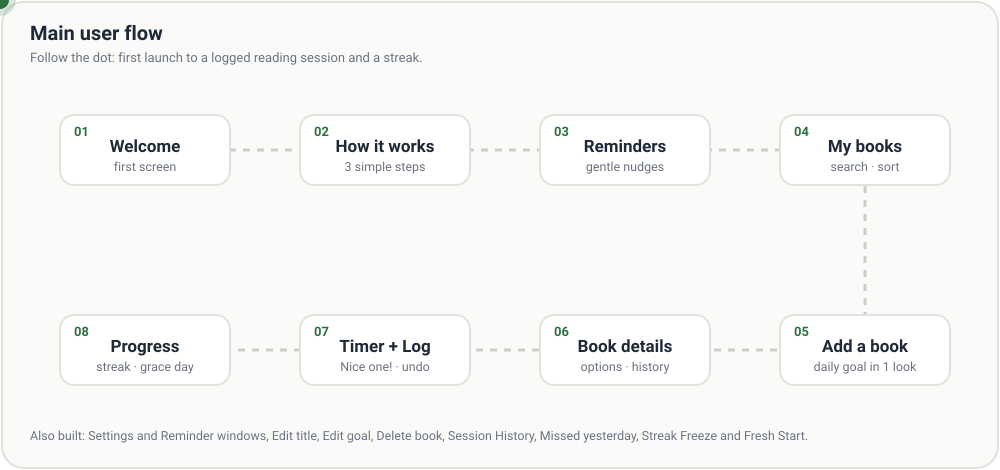
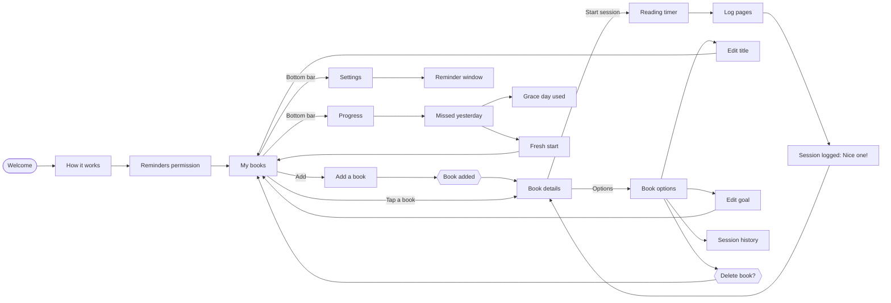
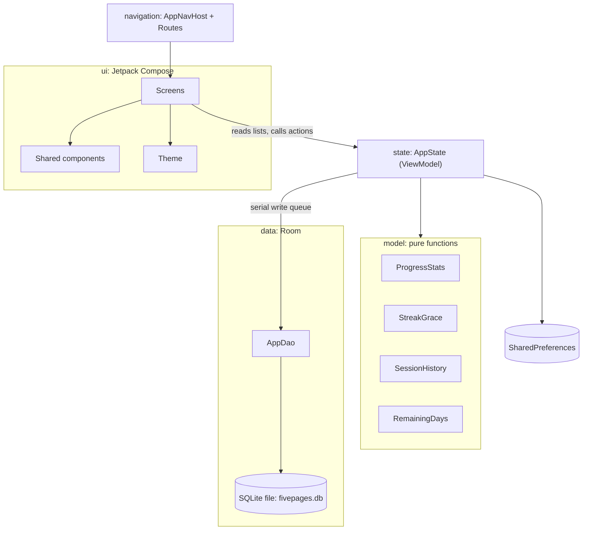
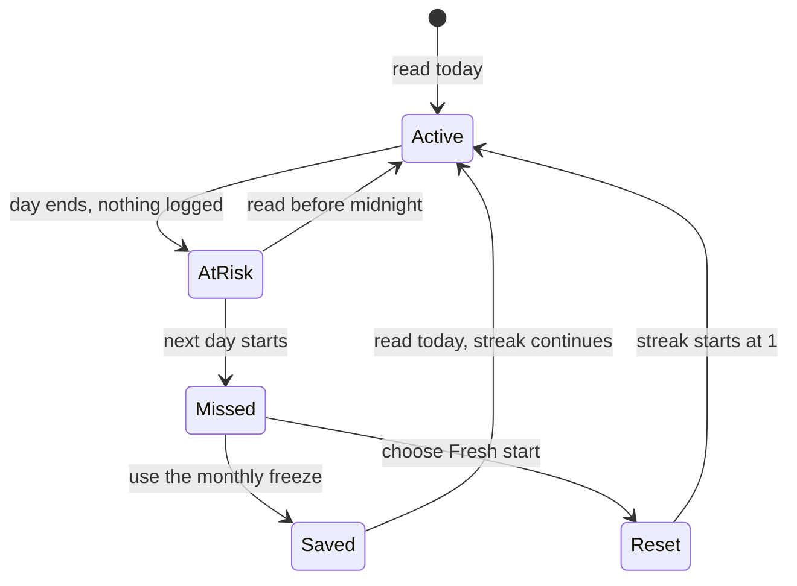

<p align="center">
  
</p>

<p align="center">
  
  
  
  
  
  
</p>

# FivePages

FivePages is a small reading tracker for people who find a thick book scary. You add a book, pick a finish date, and the app tells you how many pages to read today. Usually it is about five. You read, log your pages, and watch your streak grow.

Everything stays on the phone. No account, no internet, no ads.

**Course:** MO-IT114 Mobile Development Fundamentals, MMDC
**Milestone:** 2, functional Jetpack Compose UI built from our Figma prototype
**Group:** Mobile Dev Fundamentals Grp 1

## The team

| Member | GitHub branch work (fill in) |
|---|---|
| Franzie Frielle Mangalindan | Onboarding Screens, Settings, Reminders |
| Sire Ermond Manalo | Add Book, Book Details, Log Pages, Book, Color, Theme, Type, Library-Empty, nav-host, routes |
| Abigail Ann Sarmiento | Book options, session history, streak grace screens, theme, shared components, tests, docs |
| Christian Allen Soriano | Modularity cleanup, shared text fields and buttons, reminder dialogs, edit and streak screens |

> Each member should list their own screens and commits in the right column before submission.

---

## Contents

1. [See it work](#see-it-work)
2. [Features](#features)
3. [Project layout](#project-layout)
4. [How the app is built](#how-the-app-is-built)
5. [The streak logic](#the-streak-logic)
6. [Design system](#design-system)
7. [Run it](#run-it)
8. [Testing](#testing)
9. [Modularity: shared components](#modularity-shared-components)
10. [Design patterns](#design-patterns)
11. [User testing](#user-testing)
12. [Rubric evidence](#rubric-evidence)
13. [Beyond the Figma](#beyond-the-figma)
14. [Known limits](#known-limits)

---

## See it work

The dot below walks through the main flow. The full screen list is in the next section.

<p align="center">
  
</p>

The same flow as a diagram that shows the branches:



---

## Features

Every row is a screen or behaviour from the Figma file, and each one works in the app, not only on screen.

| Area | What it does |
|---|---|
| Onboarding | Welcome, how it works, reminder permission. Shown once, then remembered. |
| My books | List with search and sort, empty state, bottom bar. |
| Add a book | Title, total pages, finish date. Shows the daily goal as you type. Blocks empty titles and duplicates. |
| Book details | Percent done, segment bar, pages left, days left, today's goal. |
| Reading session | Timer, pause, finish, discard confirmation. |
| Log pages | Enter pages read, Nice one! screen, undo the last session. |
| Book options | Edit title, edit goal, delete book, each with its own confirm dialog. |
| Session history | Every session for a book, newest first, with date, pages and time spent. |
| Progress | Streak, this week chart, sessions this month, active books. |
| Missed yesterday | Offers to use a streak freeze. |
| Streak freeze | One free grace day per month. It saves the streak but does not add to it. |
| Fresh start | Choose to begin again when the streak cannot be saved. |
| Settings | Reminder list with on and off switches. |
| Reminder window | Add, edit and delete a reminder time. |
| Preview link | On Progress, opens the Missed yesterday screen without changing any data. |

### How the daily goal is worked out

The daily goal is the pages left divided by the days left, **rounded up to the next whole page**. One example is used everywhere in this project, including the Milestone 1 document:

> 250 pages ÷ 57 days = 4.39, which rounds up to **5 pages a day**. At 5 pages a day that is about **50 reading sessions** (250 ÷ 5).

The same rule runs on Add a book, My books, Book details and Edit goal, through one function, `dailyGoal`, so the number never differs between screens. On the last day the goal is all the pages left.

### Two ways to log a session

Use case: **log my reading for today**.

| | Main flow: with the timer | Alternative flow: log pages manually |
|---|---|---|
| Start | Book details, **Start session** | Book details, **Log pages manually** |
| Steps | Timer runs, tap finish, enter pages read | Enter the pages read, no timer |
| Result | Session saved with its pages and how long it took | Session saved with its pages and no time |
| Then | **Nice one!** screen with undo | **Nice one!** screen with undo |
| History | Shows the date, pages and time | Shows the date, pages and a dash for time |

Both flows add to the streak, the week chart and the progress percentage in the same way.

---

## Project layout

The app is one Gradle module. Files are grouped by job, not by who wrote them.

```text
FivePages/
├── README.md
├── docs/
│   ├── TEST_CASES.md              manual test-case table
│   ├── USER_TESTING.md            script and results for the classmate sessions
│   └── assets/
│       ├── banner.svg             animated header
│       └── flow.svg               animated user flow
├── build.gradle.kts
├── settings.gradle.kts
├── gradle/libs.versions.toml      version catalog
└── app/
    ├── build.gradle.kts
    └── src/
        ├── main/
        │   ├── AndroidManifest.xml
        │   ├── res/
        │   │   ├── drawable/      streak_shield, streak_comet, streak_fresh_start, icons
        │   │   └── font/          Fraunces, DM Sans, Inter
        │   └── java/com/example/fivepages/
        │       ├── MainActivity.kt          entry point, applies the theme, hosts the NavHost
        │       ├── library-empty.kt         My books screen and its empty state
        │       │
        │       ├── navigation/
        │       │   ├── Routes.kt            every route name and its builder
        │       │   └── AppNavHost.kt        the single NavHost that wires screens together
        │       │
        │       ├── state/
        │       │   └── AppState.kt          AndroidViewModel: one source of truth for the UI
        │       │
        │       ├── data/                    Room database
        │       │   ├── Entities.kt          books, sessions, reminders
        │       │   ├── AppDao.kt            queries
        │       │   └── FivePagesDatabase.kt
        │       │
        │       ├── model/                   pure Kotlin, no Android, fully unit tested
        │       │   ├── Book.kt
        │       │   ├── SessionLog.kt
        │       │   ├── ReminderWindow.kt
        │       │   ├── ProgressStats.kt     streak, week chart, month count, summary
        │       │   ├── StreakGrace.kt       freeze and missed-yesterday rules
        │       │   ├── SessionHistory.kt    history rows, duration and date text
        │       │   └── RemainingDays.kt     days left and the daily goal
        │       │
        │       └── ui/
        │           ├── theme/               Color.kt, Theme.kt, Type.kt
        │           ├── components/          shared building blocks (see below)
        │           │   ├── AppButtons.kt    PrimaryButton, OutlineButton, AppTextButton, CircleIconButton
        │           │   ├── AppControls.kt   AppTextField, AppPickerField, LabeledField, AppSwitch
        │           │   ├── AppTopBar.kt     BackTopBar, TitleTopBar
        │           │   ├── AppBottomBar.kt  AppBottomBar, AppTab
        │           │   ├── AppDialog.kt     AppDialog and its button variants
        │           │   └── PageLayout.kt    FullScreenPage, PageBody, PageDots
        │           └── screens/
        │               ├── addbook/         AddBookScreen, BookAddedDialog, BookDetailsScreen,
        │               │                    LogPagesScreen, ReadingSessionScreen,
        │               │                    SessionLoggedScreen, StartSessionDialog, DiscardSessionDialog
        │               ├── bookoptions/     BookOptionsScreen, EditTitleScreen, EditGoalScreen,
        │               │                    SessionHistoryScreen, Delete/Updated dialogs
        │               ├── onboarding/      WelcomeScreen, HowItWorksScreen, NotificationsScreen,
        │               │                    NotificationsPermission, RemindersOnDialog
        │               ├── progress/        ProgressScreen, StreakGraceScreens
        │               └── settings/        SettingsScreen, ReminderWindowScreen,
        │                                    Delete/Saved/Deleted reminder dialogs
        │
        ├── test/java/com/example/fivepages/model/
        │   ├── ProgressStatsTest.kt         11 tests
        │   ├── StreakGraceTest.kt           11 tests
        │   ├── SessionHistoryTest.kt         8 tests
        │   └── DailyGoalTest.kt              3 tests
        │   (ExampleUnitTest.kt, 1 template test, sits one folder up)
        └── androidTest/                     instrumented test template
```

---

## How the app is built



**Why it is shaped this way**

- **One state holder.** `AppState` is an `AndroidViewModel`. Screens read observable lists and call functions like `addBook`, `logPages` and `undoLastSession`. The lists update the UI when they change, which is the Observer pattern Compose already gives us.
- **Writes go through one queue.** Room writes are sent through a single `Channel`, so two quick taps cannot race each other and the screen never waits on the disk.
- **Rules live outside the UI.** Anything that can be wrong, like streak maths or "how many days left", is a plain function in `model/`. That is why it can be unit tested without an emulator.
- **One NavHost.** All routes are in `Routes.kt`, so a screen never builds a route string by hand.
- **Small settings stay small.** Flags like "onboarding finished" and "frozen days" are in SharedPreferences. Books, sessions and reminders are in Room (database version 1, sessions cascade when a book is deleted).

### Data layer

> Local storage with Room was built **ahead of schedule**. Milestone 2 is about the UI, and the database work is a later part of the course, so this is an early extra. Only the `data/` folder and `AppState` touch it. The screens and the `model/` functions never do, so it can change later without rewriting the UI.

Room is a helper on top of SQLite, the database that is already built into every Android phone. The data is stored in one file on the device, `fivepages.db`.

| Piece | Job | File |
|---|---|---|
| Database | The file on the phone that keeps the data after the app closes. | `FivePagesDatabase.kt` |
| Entities | The shape of each table. | `Entities.kt` |
| DAO | The list of actions the app can run: read, save, delete. It holds no data itself. | `AppDao.kt` |
| `AppState` | Calls the DAO and keeps the lists the screens show. | `AppState.kt` |

**Tables**

| Table | Columns | Notes |
|---|---|---|
| `books` | `id`, `title`, `totalPages`, `targetDateMillis`, `pagesRead` | One row per book |
| `sessions` | `id`, `bookId`, `pages`, `loggedAtMillis`, `durationSeconds` | Linked to `books`. Deleting a book deletes its sessions. |
| `reminders` | `id`, `label`, `hour`, `minute`, `enabled` | One row per reminder time |

**What the DAO can do**

| Action | Books | Sessions | Reminders |
|---|---|---|---|
| Read all | `getBooks` | `getSessions` | `getReminders` |
| Save or update | `upsertBook` | `upsertSession` | `upsertReminder` |
| Delete one | `deleteBookById` | `deleteSessionById` | `deleteReminderById` |

**What happens when you save a book:** the Add Book screen calls `AppState.addBook`, which puts the job in the write queue, and the queue calls `AppDao.upsertBook`. Room then writes a row to the `books` table.

**Data stays on your own device.** The database file is not part of the code, so it is never pushed to GitHub. A classmate who pulls the project gets an empty app and sees their own books only. To start fresh, clear the app's storage or uninstall it.

### Tech stack

| Part | Version |
|---|---|
| Kotlin | 1.9.0 |
| Android Gradle Plugin | 8.6.1 |
| Compose BOM / compiler | 2024.04.01 / 1.5.1 |
| Navigation Compose | 2.7.7 |
| Room + KSP | 2.6.1 + 1.9.0-1.0.13 |
| Min / target / compile SDK | 24 / 34 / 34 |

---

## The streak logic

Most reading apps are harsh about missed days. FivePages gives you a way back.



The rules, in plain words:

| Rule | Where it lives |
|---|---|
| A streak is the number of days in a row with at least one session, ending today or yesterday. | `streakEndingAt` |
| You get **1 freeze per month**. It refills on the first of the month. | `FREEZES_PER_MONTH`, `freezesLeft`, `monthKey` |
| A frozen day **keeps the streak alive but is not counted** as a reading day. | `streakWithFreezes` |
| "Missed yesterday" only shows if you read the day before, skipped yesterday, have not read today, and had a streak worth saving. | `missedYesterdayStreak` |
| **Preview** on Progress shows the screen but never uses a freeze. | `MISSED_YESTERDAY/{preview}` route |

---

## Design system

Taken from the Branding frame in Figma. Brand green is kept bright on purpose so buttons are easy to see.

| Token | Value | Use |
|---|---|---|
| `FpGreen` | `#2E6F40` | Primary buttons, progress, streak |
| Display font | Fraunces | Big titles |
| Body font | DM Sans | Buttons, labels, body text |
| UI font | Inter | Small numbers and captions |

The theme is applied once in `FivePagesTheme`, so screens use theme colours instead of picking their own.

---

## Run it

You need Android Studio and a JDK that works with Android Gradle Plugin 8.6.

```bash
git clone <this repository>
cd FivePages
./gradlew assembleDebug        # build
./gradlew installDebug         # install on a connected phone or emulator
```

Or open the folder in Android Studio, wait for Gradle sync, choose a device and press Run.

**First launch** shows onboarding. To see it again, clear the app's storage in Android settings.

**Run unit tests**

```bash
./gradlew testDebugUnitTest
```

In Android Studio you can also right-click `app/src/test` and choose *Run Tests*. Reports are saved in `app/build/reports/tests/testDebugUnitTest/index.html`.

> Android Studio may show red "errors" in the commit window that are not real. If Gradle builds, the code is fine.

---

## Testing

### Automated: 34 unit tests, all passing

<p align="center">
  
</p>

33 tests cover the pure functions in `model/`, so they run in seconds with no emulator. The 34th is the `ExampleUnitTest` that Android Studio creates with every new project.

| File | Tests | What is checked |
|---|---:|---|
| `ProgressStatsTest` | 11 | Streak counting, gap handling, week starts on Monday, sessions this month, active books, segment rounding, percent range |
| `StreakGraceTest` | 11 | Missed yesterday, freeze keeps streak, frozen day not counted, monthly refill, month key |
| `SessionHistoryTest` | 8 | Duration text (dash, under a minute, minutes, hours), page plurals, date format, only this book, newest first |
| `DailyGoalTest` | 3 | Pages split evenly over days left, last day is all pages left, rounds up to the next whole page |
| `ExampleUnitTest` | 1 | Template test from Android Studio |

<details>
<summary><b>See every test name</b></summary>

**ProgressStatsTest**
- `segments_roundUpSoAnyProgressShowsOneSegment`
- `percentDone_roundsDownAndStaysInRange`
- `dayIndex_epochIsDayZero`
- `streak_countsConsecutiveDaysEndingToday`
- `streak_staysAliveThroughYesterday`
- `streak_isZeroAfterAMissedDay`
- `streak_isZeroWithNoSessions`
- `streak_stopsAtAGap`
- `week_startsOnMondayAndSumsPagesPerDay`
- `sessionsThisMonth_ignoresEarlierMonths`
- `summary_countsOnlyUnfinishedBooksAsActive`

**StreakGraceTest**
- `missed_isZeroWhenYesterdayWasRead`
- `missed_isZeroWhenTodayAlreadyHasASession`
- `missed_returnsTheStreakThatCanBeSaved`
- `missed_isZeroWhenThereWasNoStreakToSave`
- `missed_isZeroOnceYesterdayIsFrozen`
- `freeze_keepsTheStreakAliveWithoutCountingTheFrozenDay`
- `freeze_streakContinuesWhenTodayIsRead`
- `streak_isZeroAfterAMissedDayWithoutFreeze`
- `freezesLeft_startsAtOneAndDropsToZeroAfterUse`
- `freezesLeft_refillsInANewMonth`
- `monthKey_changesOnTheFirstOfTheMonth`

**SessionHistoryTest**
- `duration_zeroShowsDash`
- `duration_underAMinuteRoundsToOneMinute`
- `duration_minutesOnly`
- `duration_hoursAndMinutes`
- `duration_wholeHours`
- `pages_singularAndPlural`
- `date_usesMonthDayYear`
- `history_onlyThisBookNewestFirst`

**DailyGoalTest**
- `dailyGoal_splitsPagesEvenlyAcrossDays`
- `dailyGoal_onTheLastDayIsAllThePagesLeft`
- `dailyGoal_roundsUpToTheNextWholePage`

</details>

### Manual: test-case table

The full table of screen-by-screen checks is in **[docs/TEST_CASES.md](docs/TEST_CASES.md)**. It covers navigation, validation, the dialogs, the streak freeze and data that must survive closing the app.

The team ran all 54 checks on October 22, 2026, on commit `fcc59ef`: **54 Pass, 0 Fail**.

Worth knowing from the testers' notes:

- **Undo** after logging goes back to the Log pages screen so you can enter the right number. Pressing back there discards the session.
- **Large phone fonts:** at the maximum text size a few words are cut off, like the "Discard" button in dialogs and "Send notification at this time" in Reminder window.
- **Suggestion:** let people type the number of pages instead of only pressing plus, because big numbers take many taps.

---

## Modularity: shared components

Before this cleanup, the back header, the bottom bar, the dialogs, the green button, the text fields, the small text buttons and the switches were copied into many screens. They now live in `ui/components/` and every screen calls them.

| Component | Replaces | Used by |
|---|---|---|
| `BackTopBar(title, onBack, trailing)` | a hand-built back arrow and title row | Add book, Book details, Log pages, Edit title, Edit goal, Book options, Session history, Reminder window, Missed yesterday screens |
| `TitleTopBar(title, style)` | a hand-built title row | My books, Progress, Settings, Reading session |
| `AppBottomBar(selected, onTabSelected)` | the bottom bar copied into three screens | My books, Progress, Settings |
| `AppDialog(icon, title, message, actions)` | each popup's own card layout | Book added, Book deleted, Delete book, Title updated, Goal updated, Discard session, Start session, Delete reminder, Reminder saved, Reminder deleted, Reminders are on |
| `PrimaryButton`, `OutlineButton`, `CircleIconButton` | repeated button styling | Add book, Book details, Log pages, Reading session, Session logged, Edit title, Edit goal, Reminder window, streak screens and the dialogs |
| `DialogPrimaryButton`, `DialogOutlineButton`, `DialogTextButton`, `DialogDangerButton` | each dialog's own copy of the button styling | every dialog. They now reuse `PrimaryButton`, `OutlineButton` and `AppTextButton` with the dialog's rounder shape |
| `AppTextButton(label, onClick, color, style, asLink)` | small text-only buttons styled by hand in each screen | Welcome, Notifications, Reading session, Session logged, Discard session, Progress, streak screens, Reminder window, and the OK / Cancel in the Add book and Edit goal date pickers |
| `AppTextField`, `AppPickerField`, `LabeledField` | the outlined text field and its label, copied into each form | Add book, Edit title, Edit goal, Reminder window |
| `AppSwitch(checked, onCheckedChange)` | the same switch colours in two screens | Settings, Reminder window |
| `FullScreenPage`, `PageBody`, `PageDots` | the full-screen layout and the onboarding dots | Welcome, How it works, Notifications, Session logged |
| `remainingDays(target, now)` | the days-left maths copied in several files | Add book, Book details, Edit goal, My books |

`CircleIconButton`, the round back button, now has a 48 dp tap area, the size Android recommends, so it is easier to hit. It looks the same, but the header row is a few pixels taller.

Warning cleanup done so far: unused imports removed, deprecated `Icons.Filled.MenuBook` and `ShowChart` replaced with their `AutoMirrored` versions, `mutableStateOf(0)` replaced with `mutableIntStateOf(0)` in Log pages, and the shared helpers take `now` as a parameter so they are testable.

---

## Design patterns

These are the patterns you can point to in the code. Each row names where to look. The reasons behind them are in [How the app is built](#how-the-app-is-built).

| Pattern | Where | What it does for us |
|---|---|---|
| **State hoisting** | Every screen, for example `EditTitleScreen(currentTitle, onBack, onSave)` | Screens get their data and actions from outside and keep no app data of their own, so they are easy to preview and reuse. |
| **Single source of truth** | `state/AppState.kt`, an `AndroidViewModel` | One place holds the books, sessions and reminders. It survives screen rotation. |
| **Observer** | `mutableStateListOf` in `AppState` | When a list changes, every screen that reads it redraws by itself. |
| **Producer and consumer queue** | The `Channel` in `AppState` | Database writes wait in one line, so two quick taps cannot race each other. |
| **DAO** | `data/AppDao.kt` | Every read and write to Room goes through one interface. Screens never touch the database. |
| **Singleton** | `FivePagesDatabase.get()` | The database file is opened once and reused. |
| **Slot API (composition)** | `AppDialog(icon, …, actions)`, `LabeledField`, `FullScreenPage`, `BackTopBar(trailing)` | Shared components take other composables as parameters, so one layout serves many screens. |
| **Pure functions for the rules** | `model/` | Streak, daily goal and history maths have no Android code, which is why the unit tests run without an emulator. |
| **One place for navigation** | `navigation/Routes.kt` and `AppNavHost.kt` | One NavHost and one list of routes. No screen builds a route string by hand. |

---

## User testing

We asked two classmates to try the app without help. The script, the observation sheet and the results table are in **[docs/USER_TESTING.md](docs/USER_TESTING.md)**.

| | Tester 1 | Tester 2 |
|---|---|---|
| Name | Maria Garcia | Luis Santos |
| Tasks finished without help | 5/5 | 5/5 |
| Biggest confusion | Tapping plus once per page, and finding the edit option | Logging pages one by one, and Done going back to the list |
| What we changed because of it | Not yet, see Problems found | Not yet, see Problems found |

The sessions were on October 22 and 23, 2026. Both testers finished every task alone in about 12 minutes and rated the app 4 out of 5. The five problems they found, and the fix we plan for each, are in the "Problems found" table in [docs/USER_TESTING.md](docs/USER_TESTING.md#problems-found).

---

## Beyond the Figma

Things we added because they made the app feel more complete:

- **Session History** with how long each session took, from timer start to finish.
- **Streak freeze** with a monthly limit, and a **Fresh start** option.
- **Room storage ahead of schedule.** Books, sessions and reminders are saved on the phone and kept after the app closes, even though the database part comes later in the course.
- **Preview** link so a grader can see the Missed yesterday screen without waiting a day.
- **Undo last session** after logging pages.
- **Duplicate title check** on Add book and Edit title.
- A shared **components** package instead of copied code.

---
## Known limits

Being honest about what is not done:

- Reminders are saved and can be switched on and off, and the app asks for notification permission during onboarding, but nothing schedules or sends the notification yet, so a reminder never actually shows up on the phone. That needs a scheduler such as `AlarmManager` or `WorkManager`.
- Data is local only. Uninstalling the app deletes it, and the database is an early extra that may be reworked in the next part of the course.

---

<p align="center">
  Made by Franzie Frielle Mangalindan, Sire Ermond Manalo, Abigail Ann Sarmiento and Christian Allen Soriano.<br>
  MO-IT114 Mobile Development Fundamentals, Mapúa Malayan Digital College.
</p>
